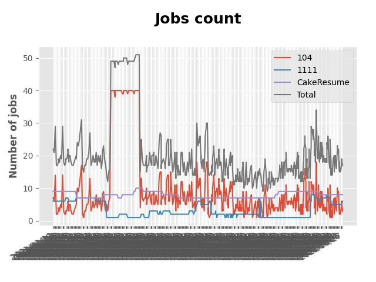

# Auto searching jobs

## Jobs include `flask` in Taiwan 

 


### Platform - 104


|    | company                                                                                     | job_title                                                                                                                | update_time   |
|---:|:--------------------------------------------------------------------------------------------|:-------------------------------------------------------------------------------------------------------------------------|:--------------|
|  1 | [思納捷科技股份有限公司](https://www.104.com.tw/company/1a2x6bk977?jobsource=jolist_d_relevance)       | [前端工程師(Python)](https://www.104.com.tw/job/7g8nn?jobsource=jolist_d_relevance)                                           | 12/16         |
|  2 | [易勝資訊股份有限公司](https://www.104.com.tw/company/1a2x6bj8og?jobsource=jolist_d_relevance)        | [Python後端工程師](https://www.104.com.tw/job/76vbt?jobsource=jolist_d_relevance)                                             | 12/20         |
|  3 | [淼森科技股份有限公司](https://www.104.com.tw/company/1a2x6blm7t?jobsource=jolist_d_relevance)        | [Web App Backend Developer 後端工程師 AWS/Flask/Postman/MySQL](https://www.104.com.tw/job/7a7i3?jobsource=jolist_d_relevance) | 12/15         |
|  4 | [漢康生技股份有限公司](https://www.104.com.tw/company/1a2x6blf97?jobsource=jolist_d_relevance)        | [細胞培養工藝開發研究員/副研究員/助理研究員](https://www.104.com.tw/job/7cccb?jobsource=jolist_d_relevance)                                  | 12/03         |
|  5 | [紅門互動股份有限公司](https://www.104.com.tw/company/oh4m67k?jobsource=jolist_d_relevance)           | [Python Flask網站開發工程師(台北)](https://www.104.com.tw/job/6xtfl?jobsource=jolist_d_relevance)                                 | 12/14         |
|  6 | [紅門互動股份有限公司](https://www.104.com.tw/company/oh4m67k?jobsource=jolist_d_relevance)           | [Python Flask網站研發工程師(台中)](https://www.104.com.tw/job/6kf9h?jobsource=jolist_d_relevance)                                 | 12/14         |
|  7 | [薩摩亞商動見科技有限公司台灣分公司](https://www.104.com.tw/company/1a2x6bkwvs?jobsource=jolist_d_relevance) | [後端工程師 Backend engineer](https://www.104.com.tw/job/7ei4a?jobsource=jolist_d_relevance)                                  | 10/14         |

### Platform - 1111


|    | company                                                                          | job_title                                                                                                 | update_time   |
|---:|:---------------------------------------------------------------------------------|:----------------------------------------------------------------------------------------------------------|:--------------|
|  1 | [(獵頭)Accurate愛客獵股份有限公司(1111 高階獵才)](https://www.1111.com.tw/corp/69647966/)       | [直播平台_Senior Backend Developer(3002871)](https://www.1111.com.tw/job/85960420/)                           | 2020-05-15    |
|  2 | [(獵頭)Accurate愛客獵股份有限公司(1111 高階獵才)](https://www.1111.com.tw/corp/69647966/)       | [Dev (Technical Lead)_知名電子公司 (3005066)](https://www.1111.com.tw/job/97459998/)                            | 2021-07-05    |
|  3 | [中租迪和股份有限公司](https://www.1111.com.tw/corp/2850037/)                              | [【中租超利士】中台架構師](https://www.1111.com.tw/job/97507405/)                                                     | 2021-12-16    |
|  4 | [台灣美光晶圓科技股份有限公司](https://www.1111.com.tw/corp/9622349/)                          | [【2021畢業生報名專區】Data Engineer, Smart MFG & AI (Taichung or Taoyuan)](https://www.1111.com.tw/job/97430572/) | 2021-12-10    |
|  5 | [台灣美光晶圓科技股份有限公司](https://www.1111.com.tw/corp/9622349/)                          | [【桃園/台中廠擴大招募】SR Data Engineer, Smart MFG & AI](https://www.1111.com.tw/job/97430508/)                     | 2021-12-10    |
|  6 | [美超微電腦股份有限公司(Super Micro Computer, Inc.)](https://www.1111.com.tw/corp/9530088/) | [Software Engineer-TC21167](https://www.1111.com.tw/job/98544764/)                                        | 2021-12-16    |

### Platform - CakeResume


|    | company                                                                      | job_title                                                                                                                           | update_time          |
|---:|:-----------------------------------------------------------------------------|:------------------------------------------------------------------------------------------------------------------------------------|:---------------------|
|  1 | [A10 Networks 睿科網路科技有限公司](https://www.cakeresume.com/companies/a10-networks) | [Sr Full-Stack Web Developer](https://www.cakeresume.com/companies/a10-networks/jobs/full-stack-web-developer-1992f2)               | Updated 3 months ago |
|  2 | [Dr. Right 精準關懷 - 搶鏡創意股份有限公司](https://www.cakeresume.com/companies/dr-right) | [後端工程師 Backend Engineer](https://www.cakeresume.com/companies/dr-right/jobs/back-end-engineer-9098f2)                               | Updated 21 days ago  |
|  3 | [Proto Research Inc](https://www.cakeresume.com/companies/proto-cx)          | [Backend Developer (Python)](https://www.cakeresume.com/companies/proto-cx/jobs/backend-developer-python)                           | Updated 3 Months ago |
|  4 | [玉山商業銀行股份有限公司](https://www.cakeresume.com/companies/esunbank)                | [後端工程師 Back-end Enginee](https://www.cakeresume.com/companies/esunbank/jobs/back-end-enginee)                                       | Updated 24 days ago  |
|  5 | [瞬聯科技股份有限公司](https://www.cakeresume.com/companies/cienet)                    | [Cloud Service 軟體工程師](https://www.cakeresume.com/companies/cienet/jobs/cloud-service-software-engineer)                             | Updated 3 Months ago |
|  6 | [紅門互動股份有限公司](https://www.cakeresume.com/companies/eagleeye-5332f1)           | [Python Flask網站開發工程師(台北)](https://www.cakeresume.com/companies/eagleeye-5332f1/jobs/python-flask-web-development-engineer-taipei)   | Updated 3 Months ago |
|  7 | [紅門互動股份有限公司](https://www.cakeresume.com/companies/eagleeye-5332f1)           | [Python Flask網站研發工程師(台中)](https://www.cakeresume.com/companies/eagleeye-5332f1/jobs/python-flask-website-r-amp-d-engineer-taichung) | Updated 3 Months ago |
|  8 | [菜蟲農食股份有限公司](https://www.cakeresume.com/companies/tsaitung)                  | [Backend Developer (Junior & Senior)](https://www.cakeresume.com/companies/tsaitung/jobs/backend-developer-junior-senior)           | Updated a month ago  |


# Getting started
## Setup Development Environment
▍Method 1 - Python Built-in venv

- Create your virtual environment
```
$ python3 -m venv venv
```
- And enable virtual environment
```
$ . venv/bin/activate
```
- Install requirements
```
$ pip install -r requirements.txt 
```

▍Method 2 - Poetry
- Install requirements
```
$ poetry install
```
- And enable virtual environment
```
$ poetry shell
```

## Setup Keyword & Run

Setup Your Keyword in [main.py](./main.py#L88)
```
if __name__ == "__main__":
    keyword = "flask"
    crawler = JobCrawler(keyword)
    crawler.run()
```

Run Crawler
```
$ python3 main.py
```

# Contributors
PRs are welcome!

This project exists thanks to all the people who contribute.

<a href="https://github.com/hsuanchi/auto-search-flask-job/graphs/contributors">
  
</a>
